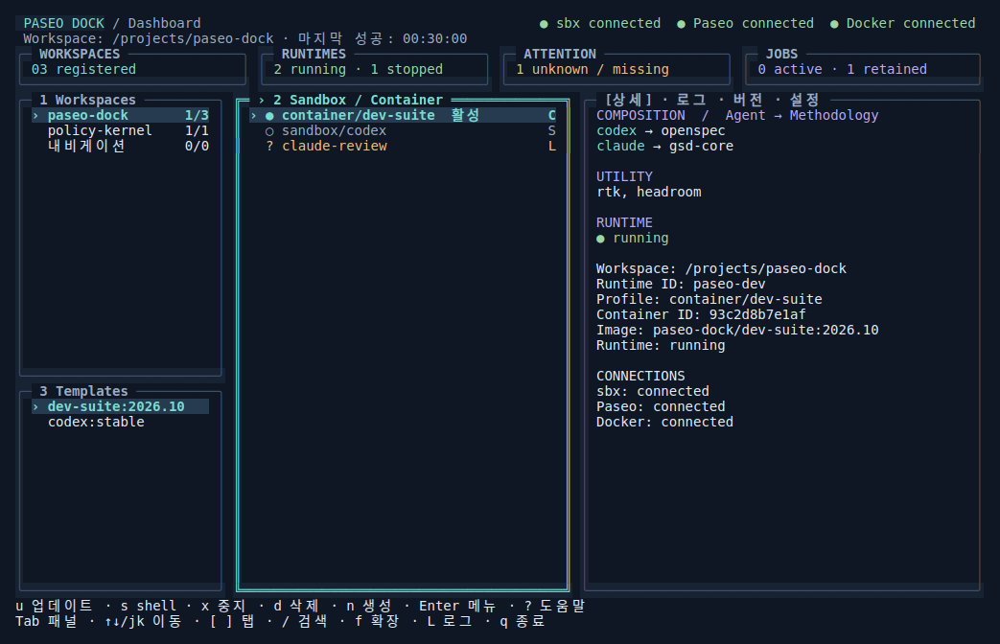
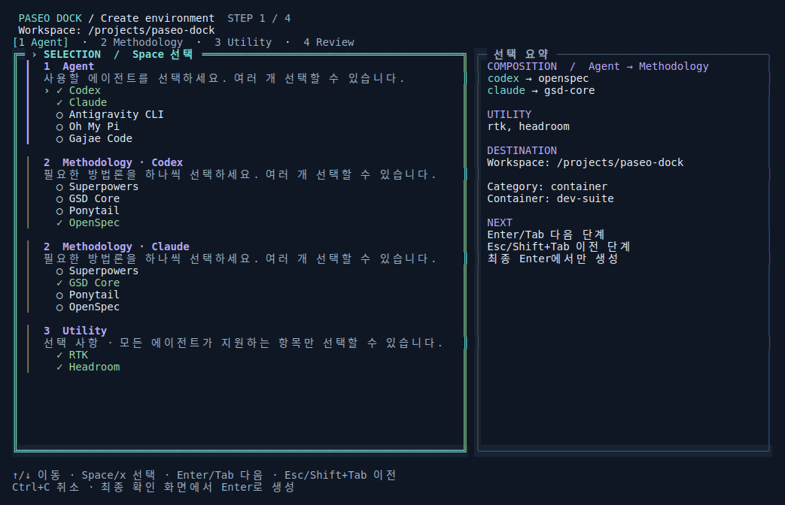

# Paseo Dock control center

## Goal and constraints

Make Workspace → runtime → Agent + Methodology + Utility composition visible,
with a coherent dark interface. Keep the Go/Bubble Tea v2/Lip Gloss v2 stack,
existing backend, asynchronous jobs, confirmations, key bindings and compact
terminal support. No new production dependencies or changes to resource policy.
Implementation and a feature-branch PR are authorized by the task request.

## Reference study

References inspected at these commits (design principles only; no copied code):

| Reference | Evidence inspected | Applied principle |
| --- | --- | --- |
| [TUIOS](https://github.com/Gaurav-Gosain/tuios/tree/5b64eae265bf6c41e73c583ee0e7f9e5d1f6ccb5) | `assets/demo.gif`, its recording tape, `internal/theme/chrome.go`, `tokens.go`, `ui.go` | Separate canvas/panel/selection surfaces, semantic accent/status roles, restrained borders and focus hierarchy |
| [OpenRig](https://github.com/mvschwarz/openrig/tree/a1f6a808d0e26c5e40f02b4e739613553d058858) | `assets/readme/openrig-agents-working.gif`, `assets/ui/screenshots/tui-topology.png`, `packages/tui/src/theme.ts`, `visual-layout.ts`, `render.ts` | Stable explorer, aligned runtime status, explicit unknown/degraded observations, summary → inventory → detail hierarchy |

TUIOS's floating/tiling window system would complicate this resource manager.
OpenRig's topology is about agent teams; paseo-dock instead needs composition
inside each runtime. Neither subsystem belongs here. An all-card dashboard would
hide long lists and cost too many rows at 80×24. Retain selectable lists and add
a composition inspector and a bounded overview.

## Design

- Palette: midnight canvas, slate panels, cyan focus, lavender section headings,
  green running/success, amber unknown/warning, red failure, readable muted text.
  Color is redundant with glyphs, text, and focus borders; `NO_COLOR` stays usable.
- At ≥110 columns and ≥28 rows: workspace/template rail, runtime list, inspector.
  At ≥80×20: stacked lists and inspector. Below that: current panel only.
- At ≥80×28: a compact summary of observed workspaces, running/stopped/unknown
  runtimes, and jobs. Unknown observations never count as healthy. Runtime state
  and provider-active state remain separate.
- Inspector: actual registered Agent → Methodology pairs and utilities first,
  then identity/runtime details. Saved workspace choices are labeled separately.
- Wizard: retain the continuous form and all keyboard behavior; add a progress
  ribbon, framed form and live composition summary when space allows. Small
  screens always retain the active choice and confirmation controls. The final
  review uses full width, wraps settings, and supports ↑↓/jk, paging, Home/End.
- Logs: fixed FOLLOW/PAUSED toolbar above scrollback, wrapped long lines, existing
  bounded storage/cancellation/retry. `L` opens expanded logs; `f` expands the
  focused panel; Esc returns. Existing tab numbers and tab ordering stay intact.
- All new presentation values pass through terminal-control sanitization.

## Implementation plan

1. Add regression tests for bundle composition, unknown summaries, expanded-log
   key isolation, color-independent bounds, and wide wizard summaries. Observe
   failure before implementing. Keep existing layout and PTY tests.
2. Add `theme.go` for semantic styling and `overview.go` for overview/composition
   presentation. Update `panels.go` and the list delegate; keep backend untouched.
3. Add expanded-panel navigation to `dashboard.go`, fixed log chrome and wrapping;
   reshape the wizard presentation in a dedicated file without changing selection.
4. Run `make test`, `make vet`, `make build`; capture real PTY output using a
   deterministic test backend, render it for visual inspection, and record sizes
   and limitations. Update README_GUI and submit the feature branch as a PR.

## Review focus

Check CJK and long names, 1-row terminals, empty/error snapshots, unknown versus
active provider state, modal/search key isolation, bundle versus saved choices,
and log follow position after resize. Captured fixture screens demonstrate the
real TUI renderer; they do not claim a live Docker/SBX integration test.

## Review and visual verification

An independent whole-change review found two regressions, both reproduced and
fixed: paused logs used a visual-row offset after reflow, and the side-by-side
wizard truncated long confirmation settings. `reflowLogOffset` preserves the
source record when the log width changes; full-width scrollable review keeps
mount paths, ports and policy text accessible. External inspector text is
sanitized before presentation styles are added.

The narrow navigation rail now displays a basename when a full path cannot fit;
selection/search still use stable identities and the inspector retains full paths.
Unlike TUIOS, there are no movable windows. Unlike OpenRig, the center inventory
represents sandbox/container resources, with their installed compositions in the
inspector rather than team/seat topology.

Captures below are actual Bubble Tea PTY output, replayed in xterm.js with a CJK
font fallback. The fixture backend is deterministic and invokes no resource
mutation. These are not HTML mockups or evidence of a live Docker deployment.

| View | Size | Evidence |
| --- | --- | --- |
| Dashboard + composition inspector | 120×40 | [PNG](../screenshots/dashboard.png) |
| Compact dashboard | 80×24 | [PNG](../screenshots/compact.png) |
| Single focused panel | 60×18 | [PNG](../screenshots/small.png) |
| Creation form overlay | 120×40 | [PNG](../screenshots/create.png) |
| Selection wizard + composition summary | 120×40 | [PNG](../screenshots/wizard.png) |
| Scrollable final review | 120×40 | [PNG](../screenshots/review.png) |
| Expanded logs | 120×32 | [PNG](../screenshots/logs.png) |





Reproduce the raw terminal captures with the existing Go test harness:

```sh
PASEO_CAPTURE_DIR=/tmp/paseo-captures go test ./internal/tui \
  -run '^TestControlCenterCapture$' -count=1 -v
```

The emitted `.ansi` files can be replayed in a terminal of the corresponding
size. Image rendering uses external development tools only; no browser, font or
JavaScript dependency was added to the application or Go module.

## Validation results

- `go test -race ./internal/tui -count=1`: passed, including keyboard/modal
  isolation, narrow-terminal bounds, composition, review scrolling and log reflow.
- `go test -race ./internal/cli -count=1`: passed. Two PTY stage waits now use
  the active progress marker because Bubble Tea updates section headings
  incrementally; assertions on created resources and policy remain intact.
- `make test-helpers`, `make vet`, and `make build`: passed.
- Seven opt-in PTY captures: passed and visually inspected at the sizes above.
- `git diff --check`: passed. `go.mod` and `go.sum` are unchanged.

The local `make test` run was not fully green: existing launcher/operations
tests require a non-root host UID/GID, whereas this execution environment maps
only UID 0. The same restriction was present in the baseline; resource policy
was not relaxed for testing. That broad run also exposed the two PTY waits fixed
above and a shell-callback timeout; the complete TUI and CLI race suites passed
on subsequent runs. GitHub Actions on a non-root runner remains the full-suite
gate. The screenshots exercise the real renderer with fixtures, not live
Docker/SBX lifecycle integration.
